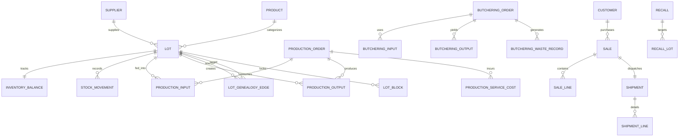

# AVATAR — Veritabanı ve Şema Mimarisi (DATABASE)

Bu belge, AVATAR Yapay Zekâ Yarışması projesinin merkezi MySQL 8.4 ve mobil yerel Room (SQLite) veritabanı mimarisini, veri modellerini, bütünlük kısıtlarını, transaction sınırlarını ve migration yönetimini açıklar.

---

## 1. Veritabanı Mimarisi ve Tek Doğruluk Kaynağı

- **Tek Doğruluk Kaynağı (Single Source of Truth):** Merkezi **MySQL 8.4 LTS** veritabanıdır.
- **Karakter Seti & Sıralama:** `utf8mb4` ve `utf8mb4_unicode_ci` tam Türkçe ve sembol desteği.
- **Depolama Motoru:** `InnoDB` (ACID uyumlu transaction'lar, satır düzeyinde kilitleme `SELECT ... FOR UPDATE`, yabancı anahtar kısıtları).
- **Hassasiyet Stratejisi:**
  - Tüm parasal değerler: `NUMERIC(19, 4)` (Kuruş ve alt birim kaybını önlemek için 4 hane).
  - Tüm miktar değerleri: `NUMERIC(19, 6)` (Hassas gramaj ve fire takibi için 6 hane).
  - Asla `FLOAT` veya `DOUBLE` kullanılmaz; Python `decimal.Decimal` ve Kotlin `BigDecimal` ile eşlenir.
- **Mobil Yerel Veritabanı:** Android Room (SQLite), merkezi veritabanının salt-okunur yerel önbelleği ve güvenli çevrimdışı satış kuyruğu (`PendingSaleEntity`) olarak çalışır.

---

## 2. Tablo Grupları ve Varlık İlişkileri

Merkezi veritabanı toplam **37 fiziksel tablodan** oluşur (Ayrıntılı alan listesi için: [`docs/DATA_MODEL.md`](DATA_MODEL.md)).



### 2.1 Katalog ve Referans Tabloları
- `units`: Ölçü birimleri (`KG`, `PACK`, `UNIT`, `G`).
- `products`: Hammadde, yarı mamul ve mamul ürün kartları (`product_type`).
- `product_prices`: Tarihçeli liste ve kampanya satış fiyatları (`price_type`, `amount`, `valid_from`).
- `suppliers`: Çiftlik, kesimhane, baharatçı ve fason dış üretim tedarikçileri (`supplier_type`).
- `customers`: Marketler ve perakende satış noktaları (`customer_type`).

### 2.2 Stok Defteri (Append-Only Inventory Ledger)
- `lots`: Tekil parti/lot tanımları (`lot_code`, `initial_quantity`, `unit_cost`, `expiry_date`, `status`).
- `inventory_balances`: Güncel stok miktarı (`on_hand_quantity`, `allocated_quantity`). Bakiye doğrudan güncellenemez; yalnızca `stock_movements` üzerinden tetiklenir.
- `stock_movements`: Değiştirilemez stok hareket defteri (`direction`: IN/OUT, `movement_type`: RECEIPT/PRODUCTION_IN/PRODUCTION_OUT/SHIPMENT/ADJUSTMENT/RETURN).
- `lot_blocks`: Aktif veya çözülmüş lot blokajları (`reason_code`, `is_active`, `blocked_at`, `unblocked_at`).

### 2.3 Üretim ve Dış Fason İşlemleri
- `production_orders`: Dış hizmet ve iç üretim emirleri (`order_code`, `production_type`, `status`, `total_cost`, `unit_cost_ekp`).
- `production_inputs`: Tüketilen hammadde lotları ve miktarları (`lot_id`, `quantity`, `cost_snapshot`).
- `production_outputs`: Üretilen mamul lotları (`lot_id`, `quantity`, `unit_cost`).
- `production_service_costs`: Fason dış hizmet faturası satırları (`description`, `quantity`, `unit_price`, `amount`).
- `lot_genealogy_edges`: Hammadde $\rightarrow$ Mamul çoktan-çoğa şecere izlenebilirlik grafları.

### 2.4 Kuzu Parçalama ve Fire
- `butchering_orders`: Karkas parçalama emirleri (`animal_type`, `input_weight`, `total_purchase_cost`, `declared_unit_price`).
- `butchering_inputs`: Parçalamaya giren karkas lotları.
- `butchering_outputs`: Çıkan parça etler (But, Sırt, Omuz vb.) ve ağırlık/değer bazlı dağıtılan maliyetler (`allocated_cost`).
- `butchering_waste_records`: Kemik, yağ ve buharlaşma fire kayıtları (`actual_weight`, `reason_code`, `allocated_cost`).
- `weight_variance_records`: Giren ağırlık ile çıkan ürün/fire arasındaki tolerans aşımı ve tutarsızlık kayıtları.

### 2.5 Satış ve Sevkiyat
- `sales`: Satış siparişleri (`sale_code`, `customer_id`, `total_amount`, `status`).
- `sale_lines`: Satış satırları (`lot_id`, `quantity`, `unit_price`, `line_total`, `stock_movement_id`).
- `shipments`: Fiziksel teslimat ve sevkiyat kayıtları (`shipment_code`, `status`, `shipped_at`).
- `shipment_lines`: Sevk edilen lot satırları.
- `idempotency_records`: Mükerrer satış ve sevkiyatı önleyen anahtar/istek hash tablosu (`scope`, `key`, `request_hash`, `response_code`, `response_body`).

### 2.6 İzlenebilirlik ve Geri Çağırma (Recall)
- `recalls`: Acil geri çağırma kararları (`recall_code`, `reason_code`, `status`).
- `recall_lots`: Geri çağırma kapsamındaki lotlar.
- `recall_customer_impacts`: Etkilenen müşteri/market ve sevk miktarı listesi.

### 2.7 Yapay Zekâ ve Anomali
- `ml_predictions`: Model A ve Model B tahminleri, baseline değerleri, gerçek sonuçlar, hata metrikleri (`MAE`, `RMSE`) ve `limitations_note`. **Finansal defterlerden tamamen izoledir.**
- `anomaly_alerts`: İstatistiki ($z$-skoru) ve çok değişkenli (`IsolationForest`) anomali uyarıları.

---

## 3. Bütünlük ve Transaction Kuralları

1. **Atomik Üretim Kabulü:**
   Bir üretim emri tamamlandığında hammadde tüketim hareketleri (`OUT`), mamul stok girişi (`IN`), maliyet snapshot'ı ve şecere kenarları (`LotGenealogyEdge`) **tek bir veritabanı transaction'ında** yazılır. Hata durumunda tamamı `ROLLBACK` edilir.
2. **Kuruş Kaybı Önleme (Rounding Invariant):**
   Maliyet dağıtımında (`BY_WEIGHT` veya `BY_VALUE`) kuruş yuvarlama artığı (`residual`) deterministik olarak son satıra eklenir; dağıtılan toplam kuruşu kuruşuna giriş maliyetine eşittir.
3. **Fail-Closed Fiyat Manipülasyon Koruması:**
   `SALES` rolündeki istemcilerin `unit_price` alanını manipüle etmesi durumunda transaction derhal iptal edilir (`400 Bad Request`).
4. **Idempotency Güvencesi:**
   Aynı `Idempotency-Key` ve aynı gövde ile gelen yinelenen isteklerde yeni stok hareketi yaratılmaz; veritabanındaki önceki sonuç `Idempotent-Replay: true` başlığıyla döndürülür. Farklı gövde gelirse `409 Conflict` ile reddedilir.

---

## 4. Migration Yönetimi (Alembic)

Migration betikleri `backend/migrations/` dizinindedir.
- Baştan sona uygulama:
  ```powershell
  cd backend
  alembic upgrade head
  ```
- Geçerli revizyon kontrolü:
  ```powershell
  alembic current
  ```
- Migration'lar SQLite ve MySQL 8.4 üzerinde çift yönlü test edilmiş ve idempotent çalışmaktadır.
