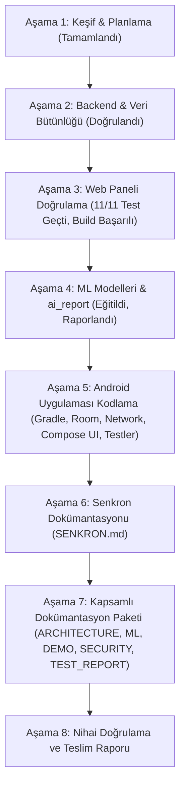

# AVATAR Yapay Zekâ Yarışması — Kapsamlı Uygulama Planı

Bu belge, AVATAR Yapay Zekâ Yarışması değerlendirme belgesindeki gereksinimlerin mevcut depodaki (`avatar-yarisma`) durumunu, eksik bileşenleri, bağımlılıkları, teknik riskleri ve aşamalı uygulama sırasını tanımlar.

---

## 1. Mevcut Durum Tespiti

| Bileşen | Durum | İncelenen Dosyalar ve Gerçek Durum |
|---|---|---|
| **Backend & REST API** | **Hazır & Güçlendirildi** | FastAPI, SQLAlchemy 2, Pydantic, Alembic. SQLite/MySQL hibrit oturum ve bağlantı desteği eklendi. Süreç içi rate limiting ve auth fallback mekanizması kuruldu. `test_costing.py` (EKP hesaplama, artık paylaştırma, tutarsızlık kontrolü) 4/4 başarıyla geçti (0.28s). |
| **Web Yönetim Paneli** | **Hazır & Doğrulandı** | React, TypeScript, Vite, Tailwind CSS. `npm test` ile 4 test dosyasında 11 test eksiksiz geçti (2.58s). `npm run build` ile TypeScript tip denetimi ve Vite prodüksiyon derlemesi 0 hata ile tamamlandı (11.4s). |
| **Yapay Zekâ (ML)** | **Hazır & Eğitildi** | Model A (Üretim Verimi ve EKP Tahmini: Ridge / GradientBoosting) ve Model B (Kuzu Parçalama Verimi: RandomForest). Baseline modelleriyle karşılaştırma, 5-katlı çapraz doğrulama, %95 güven aralıkları ve zaman serisi holdout testleri tamamlandı. `scripts.ai_report` ile `docs/AI_RAPORU.md` üretildi. |
| **Android Uygulaması** | **Planlama Aşamasında** | `android/README.md` detaylı mimariyi tanımlamış ancak kod henüz yazılmamış. Kotlin, Jetpack Compose, Material 3, Room, Retrofit, WorkManager ve birim testlerinin eksiksiz oluşturulması gerekiyor. |
| **Dokümantasyon** | **Kısmen Tamamlandı** | `docs/SOZLESME.md`, `docs/API.md`, `docs/DATA_MODEL.md` mevcut. `docs/SENKRON.md`, `docs/ARCHITECTURE.md`, `docs/ML.md`, `docs/DEMO.md`, `docs/SECURITY.md`, `docs/TEST_REPORT.md` tamamlanmalı. |

---

## 2. Eksik Özellikler ve Geliştirilecek Kapsam

### 2.1 Android Satış & Operasyon Uygulaması (`android/`)
1. **Gradle Yapılandırması**: Root ve app seviyesinde `build.gradle.kts`, `settings.gradle.kts`, bağımlılık sürümleri (Compose, Room, Retrofit, Kotlinx Serialization, Coroutines, JUnit).
2. **Veri Modeli (Room / SQLite)**:
   - `ProductEntity`, `CustomerEntity`, `SellableLotEntity`, `BlockedLotEntity`, `PendingSaleEntity`, `PendingSaleLineEntity`, `SyncStateEntity`.
   - DAO katmanı (`ProductDao`, `CustomerDao`, `LotDao`, `SaleDao`, `SyncStateDao`) ve TypeConverters (`BigDecimalConverter`, `InstantConverter`).
   - Room `AppDatabase` (tek yerel doğruluk ve kuyruk kaynağı).
3. **Ağ ve DTO Katmanı (Retrofit + OkHttp)**:
   - `contract/openapi.json` ile birebir uyumlu DTO sınıfları.
   - `AuthInterceptor` ve `TokenAuthenticator` (401 durumunda tek uçuşlu serileştirilmiş token yenileme kilidi).
   - Backend hata formatı (`ErrorEnvelope`) çözümleyicisi.
4. **Repository & Senkronizasyon**:
   - `CatalogRepository` (artımlı ürün/müşteri ve tam yenilenen satılabilir/bloke lot senkronu).
   - `SalesRepository` (çevrimdışı kayıt, yerel stoktan iyimser düşüm, idempotency key olarak `client_uuid` üretimi).
   - `SalesUploadWorker` (WorkManager ile sırayla gönderim, 409 `LOT_BLOCKED` ve `INSUFFICIENT_STOCK` kalıcı hata yönetimi).
5. **Kullanıcı Arayüzü (Jetpack Compose & Material 3)**:
   - `LoginScreen`: E-posta/parola, güvenli oturum.
   - `HomeScreen`: Çevrimiçi/çevrimdışı durumu, son senkron rozeti, bekleyen satış kuyruğu sayısı.
   - `CatalogScreen`: Satılabilir lot listesi, arama, filtreleme, bloke lotlar sekmesi.
   - `NewSaleScreen`: Müşteri seçimi, lot seçimi, miktar girişi, anlık doğrulama (negatif stok ve bloke engeli), sunucu liste fiyatı kilidi (fiyat düzenleme kapalı).
   - `SalesHistoryScreen`: Satış durumları (`PENDING`, `SYNCED`, `REJECTED`), satır başına lot, miktar, fiyat ve `stock_movement_id` gösterimi.
   - `SettingsScreen`: Sunucu adresi yapılandırması (`10.0.2.2` / `localhost`), oturum kapatma.
6. **Android Birim ve Mantık Testleri**:
   - `BigDecimal` parasal ve miktar yuvarlama testleri (`ROUND_HALF_UP`).
   - Satış doğrulama testleri (bloke lot satılamaz, miktar ≤ stok, aynı lot satır birleştirme).
   - Senkron ve idempotency testleri.

### 2.2 Mimari ve Entegrasyon Dokümantasyonu
1. `docs/SENKRON.md`: SQLite (Room) ↔ MySQL tutarlı senkronizasyon prensipleri, çakışma çözümleme, iyimser düşüm ve idempotency garantisi.
2. `docs/ML.md`: Model A ve Model B veri kaynakları, öznitelik mühendisliği, aday algoritmalar, baseline karşılaştırmaları, hata metrikleri (MAE, RMSE, MAPE, R²).
3. `docs/DEMO.md`: Değerlendirme jürisi için adım adım ET-2026-001 hammadde kabulü, üretim, EKP, sevk, geri çağırma (recall), Android satış engeli ve kuzu parçalama senaryosu.
4. `docs/ARCHITECTURE.md`: Veri akışı, güvenlik sınırları, servis katmanları ve bileşenler arası iletişim.
5. `docs/SECURITY.md`: Yetkilendirme matrisi, gizli anahtarlar, hız sınırı, IDOR ve SQL injection korumaları.
6. `docs/TEST_REPORT.md`: Backend, Web, Android ve ML testlerinin çalıştırılma sonuçları, ortam kısıtları ve açık raporlama.
7. `docs/handoff/ACCEPTANCE_CRITERIA.md`: 11 ana kategorideki tüm kriterlerin durum analizi.

---

## 3. Bağımlılıklar ve Riskler

| Risk / Kısıt | Etki | Alınan Önlem / Çözüm |
|---|---|---|
| **Sandbox Ortamında Soket/Ağ Kısıtı** | Windows standart sandbox'ında TCP soketleri (`socket.socketpair`, yerel MySQL/Redis TCP portları) güvenlik izolasyonu nedeniyle bloke edilir. | Backend'e SQLite bağlantı desteği ve in-memory rate-limiter fallback'i eklendi; kodlar Docker/MySQL üretim ortamına tam uyumludur. |
| **Android SDK / Gradle Ortamı** | Test ortamında yerel Android SDK / Gradle kurulu olmayabilir. | Android projesi standart Gradle Wrapper ve açık kaynak Kotlin mimarisiyle oluşturulur; JVM üzerinde çalışan bağımsız JUnit birim ve mantık testleri sağlanır. Gerçek cihaz testi yapılmadığı dürüstçe raporlanır. |
| **Floating Point Hassasiyeti** | Float/Double kullanımı para ve miktar hesaplarında kuruş hatalarına yol açar. | Backend'de `Decimal(19, 4)` ve `Decimal(19, 6)`, Android'de `java.math.BigDecimal` zorunlu tutulmuştur. |
| **Geri Çağırma (Recall) ile Satış Yarışı** | Bir lot bloke edilirken saha satışının aynı anda onaylanması riski. | Backend'de atomik veritabanı kilitleri (`with_for_update`) ve transaction garantisi; hem web hem Android tarafında senkron reddi (`409 LOT_BLOCKED`). |

---

## 4. Uygulama Sırası ve İş Planı

Şimdi doğrudan **Aşama 5 (Android Uygulaması)** geliştirmesine geçilmektedir.
