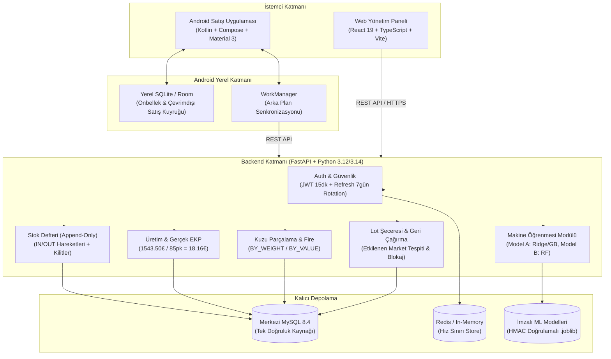

# AVATAR — Bütünleşik Sistem Mimarisi (ARCHITECTURE)

Bu belge, AVATAR Yapay Zekâ Yarışması kapsamında geliştirilen uçtan uca sistemin mimari katmanlarını, modüller arası veri akışlarını, güvenlik sınırlarını ve işlem bütünlüğü garantilerini tanımlar.

---

## 1. Mimarî Genel Bakış ve Teknoloji Yığını

---

## 2. Modüller Arası Veri Akışları

### 2.1 Hammadde Kabulü ve Stok Girişi
1. Tedarikçiden hammadde (Dana Eti, Baharat, Bağırsak veya Bütün Kuzu Karkas) teslim alınır (`lots.receive`).
2. Tekil `Lot` kaydı açılır; `stock_movements` tablosuna `direction="IN"`, `movement_type="RECEIPT"` hareketi yazılır.
3. `inventory_balances.on_hand_quantity` atomik olarak artırılır.

### 2.2 Dış Fason Üretim ve EKP Maliyeti
1. Üretim emri (`ProductionOrder`) oluşturulur; tüketilecek hammadde lotları (`production_inputs`) ve miktarları bağlanır.
2. Dış hizmet faturası (`production_service_costs`) eklenir (85 paket × 5,50 € = 467,50 €).
3. Üretim emri başlatıldığında (`IN_PROGRESS`) stok henüz düşmez.
4. Üretim kabulü (`production.complete`):
   - Hammadde lotlarından `OUT` hareketi düşülür (`on_hand_quantity` 0'a iner).
   - Mamul lotu (`SUC-2026-045`) için `IN` hareketi (85 paket) açılır.
   - Gerçek birim maliyet (EKP) hesaplanır: $\frac{1.543,50}{85} = 18,1588... \longrightarrow \mathbf{18,16\text{ €/paket}}$.
   - `LotGenealogyEdge` kayıtları ile hammadde $\rightarrow$ mamul bağlantısı kurulur.

### 2.3 Kuzu Karkas Parçalama ve Kuruş Kaybı Önleme
1. 25 kg karkas kuzu girişi yapılır. Şartnamedeki 25 kg × 11,50 € = 287,50 € vs 351,00 € çelişkisi `SOURCE_COST_MISMATCH` uyarısıyla yakalanır.
2. Parçalama emri başlatılır; 22 kg parça et (But 12, Sırt 6, Omuz 4 kg) ve 3 kg fire (`BONE_WASTE`) kaydedilir.
3. `BY_WEIGHT` yöntemiyle toplam 351,00 € maliyet parça etlere (308,88 €) ve fireye (42,12 €) dağıtılır. Kuruş yuvarlama artığı deterministik olarak son satıra aktarılır.

### 2.4 Satış, Sevkiyat ve Idempotency
1. İstemci (Android veya Web) `Idempotency-Key: <UUID>` başlığıyla satış siparişi gönderir.
2. Backend katalog fiyatını (`product_prices`) doğrular; yetkisiz fiyat manipülasyonu `400 Bad Request` ile engellenir.
3. Satış ve sevkiyat tek transaction'da tamamlanır: `Shipment` durumu `SHIPPED` olur, fiziksel stok `OUT` düşer, `stock_movement_id` satış satırına işlenir.
4. Ağ kesintisi nedeniyle aynı istek tekrar iletilirse, veritabanındaki kayıt kontrol edilir ve mükerrer stok düşümü olmadan `Idempotent-Replay: true` başlığı ile önceki yanıt döndürülür.

### 2.5 İzlenebilirlik ve Geri Çağırma (Recall)
1. `ET-2026-001` hammadde lotunda mikrobiyolojik risk tespit edildiğinde `recall.create` ve `recall.activate` çalıştırılır.
2. Sistem şecere grafı üzerinden ileriye doğru yürür: `ET-2026-001` $\rightarrow$ `URT-2026-045` $\rightarrow$ `SUC-2026-045` $\rightarrow$ Market A (30), Market B (25), Market C (30).
3. Mamul lotu `LotBlock` ile kilitlenir.
4. Bloke lot satılmaya çalışıldığında backend `409 Conflict: LOT_BLOCKED` yanıtı döner.

---

## 3. Güvenlik ve İzolasyon Sınırları

- **Rol Tabanlı Erişim Denetimi (RBAC):** `ADMIN`, `OPERATOR`, `SALES`, `TRACEABILITY_MANAGER`, `VIEWER`.
- **Hassas Maliyet Maskeleme:** `costs:read` izni olmayan kullanıcıların (`SALES`, `VIEWER`) API yanıtlarındaki tüm `unit_cost`, `total_cost`, `ekp`, `gross_profit` alanları `redact_cost_data` fonksiyonu ile maskelenir.
- **Argon2id Parola Koruması:** Demo parolası dahil tüm parolalar Argon2id algoritmasıyla hash'lenerek saklanır.
- **JWT & Token Rotation:** 15 dakikalık access token, 7 günlük refresh token; refresh reuse anında tespit edilerek oturum ailesi iptal edilir.
- **Yapay Zekâ İzolasyonu:** ML modelleri ve tahminleri (`ml_predictions`) stok defterlerinden ve muhasebe kayıtlarından tamamen izoledir.

---

## 4. Makine Öğrenmesi (ML) Servis ve Dağıtım Mimarisi

### 4.1 Çift Katmanlı ML Servis Modeli
1. **Entegre Backend ML Katmanı (`backend/app/ml/`):**
   - Ana FastAPI uygulaması (`avatar-api-1`, Port 8000) ile doğrudan sunulur.
   - Web yönetim paneli ve mobil Android uygulaması tarafından tüketilen `/api/v1/ai/` uç noktalarını yönetir.
   - Model artefaktları (`production_yield.joblib`, `butchering_output.joblib`), Docker Compose tarafından kalıcı adlandırılmış hacim olan `avatar_ml` (`/srv/ml_artifacts`) üzerinde tutulur.
   - Yeniden eğitim (`POST /api/v1/ai/models/train`), süreçler ve iş parçacıkları arası dosya kilidi (`.training.lock`) ile atomik olarak korunur.

2. **Bağımsız Model 2 Mikroservis Katmanı (`ai/Model2/`):**
   - Port 8002 üzerinde çalışan izole FastAPI mikroservisidir (`avatar-model2-api`).
   - Karkas parçalama operasyonlarının bağımsız denetimi (`model_b_audit.sqlite3`) ve gerçekleşen tartım kayıtları (`POST /v1/actual/carcass-cuts`) için kullanılır.
   - Sadece doğrulanmış `model_b_production.joblib` ve buna eşleşen `source_type=measured` manifest mevcutsa tahmin üretir; aksi takdirde **HTTP 503** ile fail-closed yanıt döner.

### 4.2 Kriptografik İzolasyon ve Bütünlük (Key Separation)
- **Anahtar Ayrımı:** Model artefaktları SHA-256 HMAC ile imzalanır (`.sig` dosyaları). İmzalama anahtarı `ML_SIGNING_SECRET` olup, kullanıcı oturum anahtarı olan `JWT_SECRET_KEY`'den tamamen bağımsızdır.
- **Yükleme Öncesi Doğrulama:** `modeling.load()` fonksiyonu dosyayı deserialize etmeden (pickle çalıştırmadan) önce imzasını bayt düzeyinde doğrular; imzasız veya kurcalanmış artefaktlar sisteme yüklenmez.

### 4.3 Dürüstlük ve Ayrım Kuralları
- **Model 1 (Üretim & EKP):** Karar desteği seviyesindedir. API yanıtında `limitations_note` ile sentetik geçmiş verisi olduğu belirtilir; muhasebe defterlerine müdahale edemez.
- **Model 2 (Karkas Parçalama):** Gerçek saha ölçümleri (`data/raw/measured/`) tamamlanana kadar sentetik aday (`model_b_synthetic_candidate.joblib`) üretim tahmini için kullanılamaz; sahte tahmin üretilmez.

