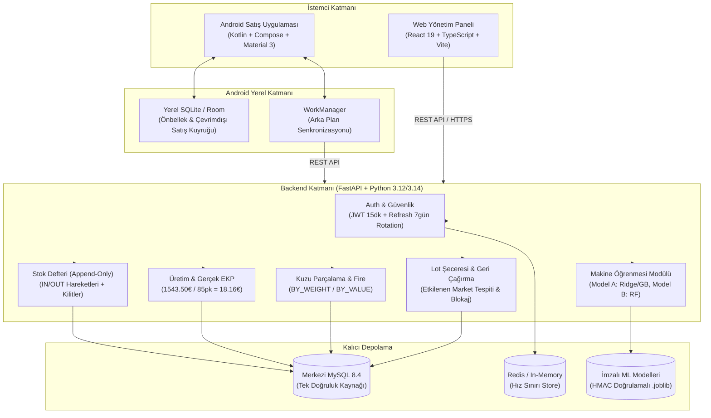

# AVATAR — Bütünleşik Sistem Mimarisi (ARCHITECTURE)

Bu belge, AVATAR Yapay Zekâ Yarışması kapsamında geliştirilen uçtan uca sistemin mimari katmanlarını, modüller arası veri akışlarını, güvenlik sınırlarını ve işlem bütünlüğü garantilerini tanımlar.

---

## 1. Mimarî Genel Bakış ve Teknoloji Yığını



---

## 2. Modüller Arası Veri Akışı ve Görev Bölüşümü

### 2.1 Web Yönetim Paneli (`web/`)
- Masaüstü ve tablet uyumlu React 19 + TypeScript + Tailwind CSS paneli.
- Üretim emirleri, kuzu parçalama reçeteleri, hammadde girişleri, stok hareketleri, müşteri/market yönetimi, ileri-geri lot izleme, geri çağırma yönetimi ve ML tahminlerini içerir.
- Rol bazlı maliyet gizleme: `costs:read` izni olmayan kullanıcılara birim maliyet (EKP) ve kâr alanları API ve arayüz seviyesinde gizlenir.

### 2.2 Android Satış ve Operasyon Uygulaması (`android/`)
- Saha satış personeli (`SALES`) ve operatörlerin mobil arayüzüdür.
- Room SQLite veritabanı yerel okuma önbelleği ve çevrimdışı işlem kuyruğudur.
- Satış oluştururken yerel UUID üretilir (`client_uuid`), `Idempotency-Key` olarak sunucuya aktarılır.
- Geri çağrılan / bloke lotların satışı hem yerelde hem sunucuda `409 LOT_BLOCKED` ile kesin olarak engellenir.
- Her satış satırında lot kodu, miktar, sabit liste fiyatı ve sunucudan dönen `stock_movement_id` kalıcı olarak saklanır.

### 2.3 Backend & REST API (`backend/`)
- FastAPI tabanlı REST API; `contract/openapi.json` tek sözleşme kaynağıdır.
- Deny-by-default yetkilendirme mimarisi; tüm endpoint'ler rol ve yetki kontrollerinden geçer.
- Hata formatı standarttır:
  ```json
  {
    "error": {
      "code": "LOT_BLOCKED",
      "message": "Bu lot geri çağrılmış/bloke edilmiştir.",
      "details": {}
    },
    "request_id": "req-xxx"
  }
  ```

---

## 3. Temel İş Akışları ve Formüller

### 3.1 Dış Hizmetle Üretim ve Gerçek Maliyet (EKP)
- **Referans Senaryo:**
  - 100 kg et × 9,70 € = 970,00 €
  - 2 kg baharat × 24,00 € = 48,00 €
  - 5 kg bağırsak × 11,60 € = 58,00 €
  - 85 paket × 5,50 € hizmet = 467,50 €
  - **Toplam Maliyet:** $970.00 + 48.00 + 58.00 + 467.50 = 1.543,50\text{ €}$
  - **Gerçek Üretim:** 85 paket
  - **Gerçek EKP:** $\frac{1.543,50}{85} = 18,158823...\text{ €}$ (hesaplamada 4 basamak, gösterimde `18,16 €`).
- Hammadde ve hizmet maliyetleri iki kez toplanmaz.
- Üretim tamamlama (`complete`), tüketim `OUT` hareketleri, mamul `IN` hareketi, lot şeceresi ve maliyet kaydını tek bir veritabanı transaction'ında atomik olarak uygular.

### 3.2 Bütün Kuzu Parçalama ve Ağırlık/Maliyet Dengesi
- Giriş: Canlı/karkas hayvan partisi (`25 kg` kuzu, alış `351,00 €`, beyan birim fiyat `11,50 €/kg`).
- PDF belgesindeki aritmetik tutarsızlık ($25 \times 11,50 = 287,50 \neq 351,00$ ve parça toplamı $22\text{ kg} \neq 25\text{ kg}$) sessizce yutulmaz; sistem aradaki farkı kullanıcıya açık uyarı ve `weight_variance_records` olarak sunar.
- Maliyet Dağıtım Yöntemleri:
  - `BY_WEIGHT`: Ağırlık oranına göre paylaştırma. Yuvarlama artıkları deterministik olarak son satıra aktarılır; kuruş farkı oluşmaz.
  - `BY_VALUE`: Ürün liste fiyatı bazlı değer ağırlıklı dağıtım.

### 3.3 Lot İzlenebilirliği ve Geri Çağırma (Recall)
- **Şecere Grafiği:**
  $$\text{Hammadde Lotu (ET-2026-001)} \longrightarrow \text{Üretim Emri (URT-2026-045)} \longrightarrow \text{Mamul Lotu (SUC-2026-045)} \longrightarrow \text{Sevkiyatlar (Market A: 30, Market B: 25, Market C: 30)}$$
- Geri çağırma aktive edildiğinde:
  1. Kaynak lot ile bağlantılı tüm üretimler, mamul lotları ve sevk edilen marketler ilişkisel grafikten recursive/join sorgularıyla anında listelenir.
  2. İlgili mamul lotları `BLOCKED` statüsüne alınır.
  3. Yeni satış ve sevkiyat istekleri veritabanı kilitleriyle (`with_for_update`) eşzamanlı yarış koşullarına karşı korunur ve reddedilir.
  4. Recall `RESOLVED` olsa dahi blokaj otomatik kalkmaz; ayrı bir yetkili `lots:unblock` işlemi gerekir.

---

## 4. Güvenlik ve İzolasyon Sınırları

1. **Parola Güvenliği:** Argon2id hash algoritması kullanılır.
2. **Token Döngüsü:**
   - Access Token: 15 dakika ömürlü JWT (`HS256`).
   - Refresh Token: 7 gün ömürlü, sunucuda SHA-256 hash ile saklanır, her kullanımda yenilenir (rotation). Eski bir refresh token tekrar kullanılırsa aile iptal edilir (family revocation).
3. **Idempotency Güvencesi:** `Idempotency-Key` başlığı satış ve sevkiyatta zorunludur. Aynı anahtar ve gövde ilk cevabı döner; aynı anahtar ve farklı gövde `409 IDEMPOTENCY_KEY_REUSED` üretir.
4. **Denetim Defteri (Audit):** Hard delete yasaktır. Her kritik işlem (giriş, üretim, parçalama, düzeltme, recall) aktör, zaman, işlem tipi ve detaylarla `audit_events` tablosuna yazılır.
