# Cilt 1.2 — ERD ve Kesin Veri Şeması

> **Normatif güncelleme — 22 Ekim 2026 (Cilt 1.32):** Bu belgedeki daha eski ve çelişen taslak ifadeler için `volume-01-32-approved-decisions-and-cross-check.md` ile Cilt 1.31'in onay kaydı önceliklidir. Bu not doküman sözleşmesini günceller; migration veya veritabanı değişikliği izni değildir.

**Durum:** İlk uygulama veri sözleşmesi  
**Tarih:** 22 Ekim 2026  
**Bağlı belgeler:** Cilt 0, Cilt 1, DEC-001, ADR-001  
**Teknoloji standardı:** MySQL 8.4 LTS, SQLAlchemy 2.x, Alembic; Android'de Room/SQLite  
**Amaç:** Backend, Android, web paneli ve farklı LLM'lerin aynı tablo ve alan sözleşmesini uygulamasını sağlamak.

> **Bağlayıcılık:** Bu belge DEC-001'deki onaylanmış kararları uygular. Aşağıdaki şema, ilk yarışma sürümü için normatif veri sözleşmesidir. Yeni bir tablo/alan eklenmesi gerekiyorsa bu belge ve ilgili API sözleşmesi birlikte güncellenmelidir. İşlem geçmişi tabloları hard delete ile silinmez.

## 1. Genel veri kuralları

### 1.1 Ortak alanlar

İşlem tablolarında uygun olduğu ölçüde şu alanlar bulunur:

| Alan | MySQL tipi | Kural |
|---|---|---|
| `id` | `BIGINT UNSIGNED` | Auto-increment primary key |
| `created_at` | `DATETIME(6)` | UTC zaman damgası |
| `created_by` | `BIGINT UNSIGNED NULL` | `users.id`; sistem tarafından oluşturulan kayıtlarda NULL olabilir |
| `updated_at` | `DATETIME(6) NULL` | Son değişiklik zamanı; UTC |
| `updated_by` | `BIGINT UNSIGNED NULL` | Son değişikliği yapan kullanıcı |

Her tabloya tüm ortak alanlar zorla eklenmez. Değişmez ledger tablolarda `updated_at`/`updated_by` kullanılmaz; düzeltme ayrı bir hareket veya ilişkilendirilmiş iptal kaydıyla yapılır.

### 1.2 Veri tipi ve gösterim kuralları

- ID: `BIGINT UNSIGNED`.
- Para: `DECIMAL(19,4)`, API'de ondalık string; ör. `"18.1600"`.
- Miktar/ağırlık: `DECIMAL(19,6)`, API'de ondalık string; ör. `"85.000000"`.
- Dönüşüm katsayısı: `DECIMAL(19,9)`.
- Tarih: `DATE`, API'de `YYYY-MM-DD`.
- Zaman: `DATETIME(6)` UTC, API'de ISO 8601 UTC (`Z`).
- Para birimi: `CHAR(3)` ISO benzeri kod; ilk demo `EUR`.
- Metin kodları: `VARCHAR`; iş kodu alanlarında `UNIQUE`.
- Enum benzeri durumlar: `VARCHAR` + uygulama doğrulaması ve gerekiyorsa DB `CHECK`; değerler `UPPER_SNAKE_CASE`.
- JSON alanları kritik ilişkisel verilerin yerine kullanılmaz. Çekirdek bağlantılar foreign key ile modellenir.

### 1.3 İsimlendirme

- Tablo ve alanlar `snake_case`, tablo adları çoğul.
- API JSON alanları `snake_case`.
- Endpoint yolları küçük harf/kebab-case.
- ORM ilişki adları Python standartlarına uygun olabilir; veritabanı alan adları değişmez.

## 2. ERD — temel ilişkiler

Aşağıdaki Mermaid ERD, ana veri ilişkilerini gösterir. Uygulama için kesin alan listeleri sonraki bölümlerdedir.

```mermaid
erDiagram
    USERS ||--o{ SALES : creates
    USERS ||--o{ PRODUCTION_ORDERS : creates
    USERS ||--o{ BUTCHERING_ORDERS : creates
    PRODUCTS ||--o{ LOTS : identifies
    SUPPLIERS ||--o{ LOTS : supplies
    CUSTOMERS ||--o{ SHIPMENTS : receives
    PRODUCTS ||--o{ PRODUCT_PRICES : priced
    UNITS ||--o{ UNIT_CONVERSIONS : source_unit
    UNITS ||--o{ UNIT_CONVERSIONS : target_unit
    LOTS ||--|| INVENTORY_BALANCES : balance
    LOTS ||--o{ STOCK_MOVEMENTS : movement
    PRODUCTION_ORDERS ||--o{ PRODUCTION_INPUTS : consumes
    PRODUCTION_ORDERS ||--o{ PRODUCTION_OUTPUTS : produces
    PRODUCTION_ORDERS ||--o{ PRODUCTION_SERVICE_COSTS : incurs
    LOTS ||--o{ PRODUCTION_INPUTS : input_lot
    LOTS ||--o{ PRODUCTION_OUTPUTS : output_lot
    BUTCHERING_ORDERS ||--o{ BUTCHERING_INPUTS : consumes
    BUTCHERING_ORDERS ||--o{ BUTCHERING_OUTPUTS : produces
    BUTCHERING_ORDERS ||--o{ BUTCHERING_WASTE_RECORDS : records_waste
    LOTS ||--o{ BUTCHERING_INPUTS : input_lot
    LOTS ||--o{ BUTCHERING_OUTPUTS : output_lot
    LOTS ||--o{ BUTCHERING_WASTE_RECORDS : source_lot
    LOTS ||--o{ LOT_GENEALOGY_EDGES : source_or_target
    SALES ||--|{ SALE_LINES : contains
    LOTS ||--o{ SALE_LINES : sold_from
    CUSTOMERS ||--o{ SHIPMENTS : receives
    SHIPMENTS ||--|{ SHIPMENT_LINES : contains
    LOTS ||--o{ SHIPMENT_LINES : shipped_from
    RECALLS ||--o{ RECALL_LOTS : blocks
    LOTS ||--o{ RECALL_LOTS : affected
    RECALLS ||--o{ RECALL_CUSTOMER_IMPACTS : tracks
    CUSTOMERS ||--o{ RECALL_CUSTOMER_IMPACTS : notified
    LOTS ||--o{ LOT_BLOCKS : block_history
    USERS ||--o{ AUDIT_EVENTS : performs
    USERS ||--o{ ML_PREDICTIONS : requests
```

**ERD yorumları**
- `lot_genealogy_edges` üretim/parçalama/yeniden işleme için kaynak lot ile hedef lot arasında miktarlı, çoktan çoğa bağlantı tutar.
- `production_inputs` ve `production_outputs` işlem belgesinin satırlarıdır; genealogy kenarları ileri/geriye izleme için açık ve hızlı bir ilişki sağlar. İki kayıt türü aynı transaction içinde yazılır.
- `inventory_balances` bir lot için güncel merkezi bakiyeyi tutar; `stock_movements` denetlenebilir hareket geçmişidir.
- Market sevkiyatı, marketin son tüketiciye yaptığı satış anlamına gelmez. İkinci kademe dağıtım ancak ayrıca kaydedilmişse raporlanabilir.
- Kullanıcı-rol ilişkisinde bir kullanıcının birden çok rolü olabilir.

## 3. Kimlik doğrulama ve erişim

### 3.1 `users`

| Alan | Tip | NULL | Kısıt / açıklama |
|---|---|---:|---|
| `id` | `BIGINT UNSIGNED` | Hayır | PK |
| `email` | `VARCHAR(254)` | Hayır | `UNIQUE`; normalize edilmiş küçük harfli e-posta |
| `password_hash` | `VARCHAR(255)` | Hayır | Düz metin parola tutulmaz |
| `display_name` | `VARCHAR(120)` | Hayır | Görünen ad |
| `is_active` | `BOOLEAN` | Hayır | Default `TRUE` |
| `created_at` | `DATETIME(6)` | Hayır | UTC |
| `updated_at` | `DATETIME(6)` | Evet | UTC |

### 3.2 `roles` ve `user_roles`

`roles`: `id BIGINT PK`, `code VARCHAR(40) UNIQUE NOT NULL`, `name VARCHAR(100) NOT NULL`.

Başlangıç rolleri: `ADMIN`, `OPERATOR`, `SALES`, `TRACEABILITY_MANAGER`, `VIEWER`.

`user_roles`: `user_id BIGINT FK users.id`, `role_id BIGINT FK roles.id`, `created_at DATETIME(6)`; composite PK (`user_id`, `role_id`). Kullanıcı birden fazla role sahip olabilir.

## 4. Katalog ve birimler

### 4.1 `products`

| Alan | Tip | NULL | Kısıt / açıklama |
|---|---|---:|---|
| `id` | `BIGINT UNSIGNED` | Hayır | PK |
| `code` | `VARCHAR(64)` | Hayır | UNIQUE; ürün iş kodu |
| `name` | `VARCHAR(160)` | Hayır | |
| `product_type` | `VARCHAR(32)` | Hayır | `RAW_MATERIAL`, `INTERMEDIATE`, `FINISHED_GOOD`, `BYPRODUCT` |
| `base_unit_code` | `VARCHAR(16)` | Hayır | FK `units.code` |
| `is_lot_tracked` | `BOOLEAN` | Hayır | Default `TRUE` for stock-bearing food items |
| `is_active` | `BOOLEAN` | Hayır | Default `TRUE` |
| `created_at` | `DATETIME(6)` | Hayır | UTC |
| `updated_at` | `DATETIME(6)` | Evet | UTC |

`product_type` ürünün rolünü belirtir; lot durumu ve stok miktarıyla karıştırılmaz.

### 4.2 `units`

| Alan | Tip | NULL | Kısıt / açıklama |
|---|---|---:|---|
| `code` | `VARCHAR(16)` | Hayır | PK; ör. `KG`, `G`, `PACK`, `PCS` |
| `name` | `VARCHAR(80)` | Hayır | |
| `dimension` | `VARCHAR(16)` | Hayır | `MASS`, `COUNT`, `VOLUME` vb. |
| `is_active` | `BOOLEAN` | Hayır | Default `TRUE` |

### 4.3 `unit_conversions`

`id BIGINT PK`, `from_unit_code VARCHAR(16) FK units.code`, `to_unit_code VARCHAR(16) FK units.code`, `factor DECIMAL(19,9) NOT NULL CHECK (factor > 0)`, `created_at DATETIME(6)`.

Unique: (`from_unit_code`, `to_unit_code`). Boyutları farklı birimler arasında genel dönüşüm yapılamaz; ürün özelinde tanımlı dönüşüm gerekiyorsa ayrıca ürün bazlı kural gerekir.

### 4.4 `suppliers`

`id BIGINT PK`, `code VARCHAR(64) UNIQUE NOT NULL`, `name VARCHAR(160) NOT NULL`, `supplier_type VARCHAR(32) NOT NULL` (`RAW_MATERIAL`, `OUTSOURCED_PROCESSOR`, `BOTH`), `phone VARCHAR(40) NULL`, `email VARCHAR(254) NULL`, `is_active BOOLEAN NOT NULL DEFAULT TRUE`, `created_at DATETIME(6)`, `updated_at DATETIME(6) NULL`.

### 4.5 `customers`

`id BIGINT PK`, `code VARCHAR(64) UNIQUE NOT NULL`, `name VARCHAR(160) NOT NULL`, `customer_type VARCHAR(32) NOT NULL` (`MARKET`, `BUSINESS`, `OTHER`), `phone VARCHAR(40) NULL`, `email VARCHAR(254) NULL`, `is_active BOOLEAN NOT NULL DEFAULT TRUE`, `created_at DATETIME(6)`, `updated_at DATETIME(6) NULL`.

### 4.6 `product_prices`

Fiyat geçmişini korur; eski işlem maliyetleri yeni fiyatla değiştirilmez.

`id BIGINT PK`, `product_id BIGINT FK products.id`, `price_type VARCHAR(24)` (`PURCHASE`, `SALE`, `SERVICE`), `amount DECIMAL(19,4) CHECK (amount >= 0)`, `currency_code CHAR(3) NOT NULL DEFAULT 'EUR'`, `unit_code VARCHAR(16) FK units.code`, `valid_from DATETIME(6) NOT NULL`, `valid_to DATETIME(6) NULL`, `created_at DATETIME(6)`, `created_by BIGINT FK users.id NULL`.

İndeks: (`product_id`, `price_type`, `valid_from`). Aynı ürün/fiyat türü için çakışan geçerlilik aralıklarını engellemek uygulama servisinin sorumluluğundadır.

## 5. Lot ve stok

### 5.1 `lots`

| Alan | Tip | NULL | Kısıt / açıklama |
|---|---|---:|---|
| `id` | `BIGINT UNSIGNED` | Hayır | PK |
| `lot_code` | `VARCHAR(80)` | Hayır | UNIQUE |
| `product_id` | `BIGINT UNSIGNED` | Hayır | FK `products.id` |
| `supplier_id` | `BIGINT UNSIGNED` | Evet | FK `suppliers.id`; tedarikçi kökenli lotlarda |
| `received_at` | `DATETIME(6)` | Evet | UTC; başlangıç/teslim alma zamanına göre |
| `expiry_date` | `DATE` | Evet | Uygulanabiliyorsa |
| `initial_quantity` | `DECIMAL(19,6)` | Hayır | `>= 0`; açılış miktarı/ilk oluşturulan miktar |
| `unit_code` | `VARCHAR(16)` | Hayır | FK `units.code` |
| `lot_origin_type` | `VARCHAR(24)` | Hayır | `PURCHASE`, `PRODUCTION`, `BUTCHERING`, `REWORK`, `OPENING_STOCK` |
| `status` | `VARCHAR(24)` | Hayır | `ACTIVE`, `EXHAUSTED`, `CLOSED`; blokaj ayrı tabloda |
| `created_at` | `DATETIME(6)` | Hayır | UTC |
| `created_by` | `BIGINT UNSIGNED` | Evet | FK `users.id` |

**Kural:** `BLOCKED` kalıcı lot durumu değildir. Blokaj geçmişi `lot_blocks`/`recall_lots` üzerinden tutulur; lot aynı anda fiziksel stok taşıyabilir ve satışa kapalı olabilir.

### 5.2 `inventory_balances`

| Alan | Tip | NULL | Kısıt / açıklama |
|---|---|---:|---|
| `lot_id` | `BIGINT UNSIGNED` | Hayır | PK + FK `lots.id`; lot başına tek bakiye |
| `on_hand_quantity` | `DECIMAL(19,6)` | Hayır | Default `0`, `>= 0` |
| `reserved_quantity` | `DECIMAL(19,6)` | Hayır | Default `0`, `>= 0` |
| `updated_at` | `DATETIME(6)` | Hayır | UTC |

Kullanılabilir miktar = `on_hand_quantity - reserved_quantity`. İlk sürümde satış rezervasyonu kullanılmayacaksa `reserved_quantity` sıfır kalır; alan sonraki süreçler için açık ve tutarlı bırakılır. Eksi bakiye yasaktır.

### 5.3 `stock_movements`

| Alan | Tip | NULL | Kısıt / açıklama |
|---|---|---:|---|
| `id` | `BIGINT UNSIGNED` | Hayır | PK |
| `product_id` | `BIGINT UNSIGNED` | Hayır | FK `products.id` |
| `lot_id` | `BIGINT UNSIGNED` | Hayır | FK `lots.id` |
| `direction` | `VARCHAR(3)` | Hayır | `IN` veya `OUT` |
| `movement_type` | `VARCHAR(32)` | Hayır | `RECEIPT`, `PRODUCTION_ISSUE`, `PRODUCTION_RECEIPT`, `BUTCHERING_INPUT`, `BUTCHERING_OUTPUT`, `SHIPMENT`, `RETURN`, `TRANSFER_IN`, `TRANSFER_OUT`, `WASTE`, `REWORK_ISSUE`, `REWORK_RECEIPT`, `ADJUSTMENT` |
| `quantity` | `DECIMAL(19,6)` | Hayır | `> 0`; daima mutlak miktar |
| `unit_code` | `VARCHAR(16)` | Hayır | FK `units.code` |
| `source_type` | `VARCHAR(32)` | Hayır | Kaynak belge türü |
| `source_id` | `BIGINT UNSIGNED` | Hayır | Kaynak belgenin dahili ID'si |
| `source_line_id` | `BIGINT UNSIGNED` | Evet | Kaynak satır ID'si; polimorfik FK olduğu için servis katmanı doğrular |
| `idempotency_key` | `VARCHAR(128)` | Evet | Kaynak türü/ID ile tekrar önleme |
| `occurred_at` | `DATETIME(6)` | Hayır | İşlemin etkili olduğu UTC zamanı |
| `created_at` | `DATETIME(6)` | Hayır | Sisteme kaydedilme zamanı |
| `created_by` | `BIGINT UNSIGNED` | Evet | FK `users.id` |

İndeksler: (`lot_id`, `occurred_at`), (`product_id`, `occurred_at`), (`source_type`, `source_id`), (`idempotency_key`). Hareket geçmişi güncellenmez/silinmez. Bakiye değişimi ile hareket aynı transaction içinde yazılır.

### 5.4 `lot_blocks`

`id BIGINT PK`, `lot_id BIGINT FK lots.id`, `reason_code VARCHAR(40) NOT NULL`, `reason_text VARCHAR(500) NULL`, `source_type VARCHAR(32) NOT NULL`, `source_id BIGINT UNSIGNED NOT NULL`, `blocked_at DATETIME(6) NOT NULL`, `blocked_by BIGINT FK users.id NULL`, `unblocked_at DATETIME(6) NULL`, `unblocked_by BIGINT FK users.id NULL`, `created_at DATETIME(6) NOT NULL`.

İndeks: (`lot_id`, `blocked_at`, `unblocked_at`). Aktif blokaj: `unblocked_at IS NULL`. Bir lot için birden fazla tarihsel blokaj kaydı olabilir. Satış kontrolü herhangi bir aktif blokaj bulunup bulunmadığını kontrol eder.

## 6. Üretim

### 6.1 `production_orders`

`id BIGINT PK`, `order_code VARCHAR(80) UNIQUE NOT NULL`, `production_type VARCHAR(32) NOT NULL` (`IN_HOUSE`, `OUTSOURCED`), `status VARCHAR(24) NOT NULL` (`DRAFT`, `IN_PROGRESS`, `COMPLETED`, `CANCELLED`), `planned_quantity DECIMAL(19,6) NULL`, `planned_unit_code VARCHAR(16) FK units.code NULL`, `started_at DATETIME(6) NULL`, `completed_at DATETIME(6) NULL`, `supplier_id BIGINT FK suppliers.id NULL` (dış hizmet üreticisi), `notes VARCHAR(1000) NULL`, `created_at DATETIME(6)`, `created_by BIGINT FK users.id NULL`, `updated_at DATETIME(6) NULL`.

İş kodu örneği: `URT-2026-045`. `COMPLETED` işlem yeniden stok hareketi üretmemeli; tamamlama idempotent olmalı.

### 6.2 `production_inputs`

`id BIGINT PK`, `production_order_id BIGINT FK production_orders.id`, `product_id BIGINT FK products.id`, `lot_id BIGINT FK lots.id`, `quantity DECIMAL(19,6) CHECK (quantity > 0)`, `unit_code VARCHAR(16) FK units.code`, `unit_cost DECIMAL(19,4) CHECK (unit_cost >= 0)`, `total_cost DECIMAL(19,4) CHECK (total_cost >= 0)`, `created_at DATETIME(6)`.

Her girdi lotu ve tüketilen miktar açıkça kaydedilir. `total_cost`, işlem anındaki maliyet snapshot'ıdır; fiyat geçmişi değişince geriye dönük güncellenmez.

### 6.3 `production_outputs`

`id BIGINT PK`, `production_order_id BIGINT FK production_orders.id`, `product_id BIGINT FK products.id`, `lot_id BIGINT FK lots.id`, `quantity DECIMAL(19,6) CHECK (quantity > 0)`, `unit_code VARCHAR(16) FK units.code`, `created_at DATETIME(6)`.

Her çıktı mamul lotuna bağlanır. Bir üretim emri birden çok çıktı lotu oluşturabilir.

### 6.4 `production_service_costs`

`id BIGINT PK`, `production_order_id BIGINT FK production_orders.id`, `supplier_id BIGINT FK suppliers.id NULL`, `description VARCHAR(200) NOT NULL`, `amount DECIMAL(19,4) CHECK (amount >= 0)`, `currency_code CHAR(3) NOT NULL DEFAULT 'EUR'`, `occurred_at DATETIME(6) NOT NULL`, `created_at DATETIME(6)`.

Dış hizmet maliyeti girdilerden ayrı tutulur; üretim maliyet hesabı girdilerin maliyeti + hizmet maliyetlerini kullanır. Maliyet hesaplama ve birim maliyete dağıtım kuralı Cilt 2'de uygulanır.

## 7. Parçalama

### 7.1 `butchering_orders`

`id BIGINT PK`, `order_code VARCHAR(80) UNIQUE NOT NULL`, `status VARCHAR(24) NOT NULL` (`DRAFT`, `IN_PROGRESS`, `COMPLETED`, `CANCELLED`), `animal_type VARCHAR(40) NOT NULL`, `input_weight DECIMAL(19,6) NOT NULL CHECK (input_weight > 0)`, `input_unit_code VARCHAR(16) FK units.code`, `total_purchase_cost DECIMAL(19,4) NOT NULL CHECK (total_purchase_cost >= 0)`, `currency_code CHAR(3) NOT NULL DEFAULT 'EUR'`, `allocation_method VARCHAR(24) NOT NULL` (`BY_WEIGHT`, `BY_VALUE`), `started_at DATETIME(6) NULL`, `completed_at DATETIME(6) NULL`, `notes VARCHAR(1000) NULL`, `created_at DATETIME(6)`, `created_by BIGINT FK users.id NULL`.

### 7.2 `butchering_inputs`

`id BIGINT PK`, `butchering_order_id BIGINT FK butchering_orders.id`, `lot_id BIGINT FK lots.id`, `product_id BIGINT FK products.id`, `quantity DECIMAL(19,6) CHECK (quantity > 0)`, `unit_code VARCHAR(16) FK units.code`, `cost_snapshot DECIMAL(19,4) CHECK (cost_snapshot >= 0)`, `created_at DATETIME(6)`.

Girdi lotu gerçek stok lotu olmalıdır. Hayvan alımı için lot kaydı oluşturulup bu lottan giriş yapılır.

### 7.3 `butchering_outputs` — stokta izlenen çıktılar

`id BIGINT UNSIGNED PK`, `butchering_order_id BIGINT UNSIGNED FK butchering_orders.id`, `product_id BIGINT UNSIGNED FK products.id NOT NULL`, `lot_id BIGINT UNSIGNED FK lots.id NOT NULL`, `output_type VARCHAR(24) NOT NULL` (`CUT`, `BYPRODUCT`), `actual_weight DECIMAL(19,6) NOT NULL CHECK (actual_weight >= 0)`, `unit_code VARCHAR(16) FK units.code NOT NULL`, `allocation_weight DECIMAL(19,6) NULL`, `allocation_value DECIMAL(19,4) NULL`, `allocated_cost DECIMAL(19,4) NOT NULL CHECK (allocated_cost >= 0)`, `created_at DATETIME(6)`.

Bu tabloda yalnızca stokta izlenecek kesim (`CUT`) ve stokta izlenecek yan ürün (`BYPRODUCT`) bulunur. Her satırın ürünü ve çıktı lotu zorunludur. `WASTE` bu tabloya yazılmaz.

### 7.4 `butchering_waste_records` — fire ölçümleri ve maliyet uzlaştırması

| Alan | Tip | NULL? | Kural |
|---|---|---:|---|
| `id` | `BIGINT UNSIGNED` PK | Hayır | Dahili kimlik |
| `butchering_order_id` | `BIGINT UNSIGNED` FK `butchering_orders.id` | Hayır | İlgili parçalama emri |
| `input_lot_id` | `BIGINT UNSIGNED` FK `lots.id` | Hayır | Fire oluşan kaynak/girdi lotu |
| `actual_weight` | `DECIMAL(19,6)` | Hayır | `>= 0`; ağırlık dengesine dahil edilir |
| `unit_code` | `VARCHAR(16)` FK `units.code` | Hayır | Girdiyle uyumlu ağırlık birimine dönüştürülebilir olmalı |
| `reason_code` | `VARCHAR(40)` | Hayır | Kanonik fire nedeni; ilk sözlük ayrıca tanımlanmalı |
| `notes` | `VARCHAR(1000)` | Evet | Açıklama; boşsa `NULL` |
| `allocated_cost` | `DECIMAL(19,4)` | Hayır | Fire/kayıp maliyeti; `>= 0`, seçilen dağıtım yöntemiyle uzlaştırılır |
| `created_at` | `DATETIME(6)` | Hayır | UTC |

Fire kaydı stok lotu veya satılabilir ürün yaratmaz; stok `IN` hareketi ve lot genealogy hedefi üretmez. Fire ağırlığı ağırlık dengesi hesabına girer. Tamamlamada `SUM(butchering_outputs.allocated_cost) + SUM(butchering_waste_records.allocated_cost) = butchering_orders.total_purchase_cost` olmalıdır; yuvarlama farkı deterministik olarak son maliyet payına uygulanır ve test edilir. Dağıtım yöntemi `BY_VALUE` olduğunda fire maliyet payının hesaplama esası ayrıca Cilt 1.17 açık karar tablosunda işaretlenmiştir; bu kural kesinleşmeden migration üretilemez.

## 8. Lot kökeni ve izlenebilirlik

### 8.1 `lot_genealogy_edges`

| Alan | Tip | Kural |
|---|---|---|
| `id` | `BIGINT UNSIGNED` PK | Dahili ID |
| `source_lot_id` | `BIGINT UNSIGNED` FK `lots.id` | Kaynak lot |
| `target_lot_id` | `BIGINT UNSIGNED` FK `lots.id` | Hedef lot |
| `process_type` | `VARCHAR(24)` | `PRODUCTION`, `BUTCHERING`, `REWORK` |
| `process_id` | `BIGINT UNSIGNED` | Süreç belgesi ID'si; servis katmanı doğrular |
| `source_quantity` | `DECIMAL(19,6)` | Kaynak lotundan tüketilen miktar |
| `source_unit_code` | `VARCHAR(16)` FK `units.code` | Kaynak birim |
| `target_quantity` | `DECIMAL(19,6)` | Hedef lotuna üretilen miktar |
| `target_unit_code` | `VARCHAR(16)` FK `units.code` | Hedef birim |
| `created_at` | `DATETIME(6)` | UTC |

İndeksler: (`source_lot_id`), (`target_lot_id`), (`process_type`, `process_id`). Kaynak ve hedef lot aynı olamaz (`CHECK source_lot_id <> target_lot_id`). Kenarların oluşturulması ilgili girdi/çıktı satırları ve stok hareketleriyle aynı transaction içinde yapılır.

### 8.2 İzlenebilirlik kuralları

- **Geriye doğru:** hedef lot → önceki lot(lar) → tedarikçi/girdi kaydı.
- **İleri doğru:** kaynak lot → ilişkili üretim/parçalama → çıktı lotları → sevkiyat/satış satırları.
- Sorgular döngüleri engellemek için ziyaret edilmiş lot ID kümesi tutmalıdır.
- Miktarları farklı birimlerdeki lotlar arasında doğrudan toplayıp tek toplam gibi sunma.
- Kayıtlı olmayan alt dağıtım, teslimat veya son tüketici satışı tahmin edilmez.

## 9. Satış ve sevkiyat

### 9.1 `sales`

`id BIGINT PK`, `sale_code VARCHAR(80) UNIQUE NOT NULL`, `status VARCHAR(24) NOT NULL` (`COMPLETED`, `VOIDED`, `REFUNDED`), `sold_at DATETIME(6) NOT NULL`, `currency_code CHAR(3) NOT NULL DEFAULT 'EUR'`, `total_amount DECIMAL(19,4) NOT NULL CHECK (total_amount >= 0)`, `created_at DATETIME(6)`, `created_by BIGINT FK users.id NULL`.

### 9.2 `sale_lines`

`id BIGINT PK`, `sale_id BIGINT FK sales.id`, `line_number INT UNSIGNED NOT NULL`, `product_id BIGINT FK products.id`, `lot_id BIGINT FK lots.id`, `quantity DECIMAL(19,6) NOT NULL CHECK (quantity > 0)`, `unit_code VARCHAR(16) FK units.code`, `unit_price DECIMAL(19,4) NOT NULL CHECK (unit_price >= 0)`, `line_total DECIMAL(19,4) NOT NULL CHECK (line_total >= 0)`, `currency_code CHAR(3) NOT NULL DEFAULT 'EUR'`, `created_at DATETIME(6)`.

Unique: (`sale_id`, `line_number`). Backend `line_total` ve `total_amount` değerlerini doğrular; istemcinin gönderdiği hesaplamayı doğrudan güvenilir kabul etmez. İlk sürümde her satır tam olarak bir lota bağlanır; bir ürün birden çok lottan satılacaksa ayrı satırlar kullanılır. **Satış kaydı ticari işlemdir; `sales`/`sale_lines` hiçbir koşulda fiziksel stok `OUT` hareketi oluşturmaz veya bakiyeyi azaltmaz. Fiziksel stok çıkışının tek sahibi sevkiyat dispatch işlemidir. Fiziksel ürün müşteriye/markete çıkıyorsa ilgili dispatch kaydı bulunmalıdır.**

### 9.3 `shipments`

`id BIGINT PK`, `shipment_code VARCHAR(80) UNIQUE NOT NULL`, `customer_id BIGINT FK customers.id`, `status VARCHAR(24) NOT NULL` (`DRAFT`, `SHIPPED`, `CANCELLED`, `RETURNED`), `shipped_at DATETIME(6) NULL`, `currency_code CHAR(3) NOT NULL DEFAULT 'EUR'`, `notes VARCHAR(1000) NULL`, `created_at DATETIME(6)`, `created_by BIGINT FK users.id NULL`.

### 9.4 `shipment_lines`

`id BIGINT PK`, `shipment_id BIGINT FK shipments.id`, `line_number INT UNSIGNED NOT NULL`, `product_id BIGINT FK products.id`, `lot_id BIGINT FK lots.id`, `quantity DECIMAL(19,6) NOT NULL CHECK (quantity > 0)`, `unit_code VARCHAR(16) FK units.code`, `created_at DATETIME(6)`.

Unique: (`shipment_id`, `line_number`). Dispatch sırasında her sevkiyat satırı için stok `OUT/SHIPMENT` hareketi ve bakiye güncellemesi aynı transaction içinde oluşturulur. Bu, fiziksel stok çıkışını oluşturan tek işlemdir. İptal edilmiş taslak sevkiyat stok düşmez. Aynı sevkiyatın tekrar dispatch edilmesi ikinci bir hareket oluşturmaz.

### 9.5 `idempotency_records`

`id BIGINT PK`, `scope_key VARCHAR(160) NOT NULL`, `idempotency_key VARCHAR(128) NOT NULL`, `request_hash CHAR(64) NOT NULL`, `response_status SMALLINT UNSIGNED NOT NULL`, `response_body JSON NOT NULL`, `created_at DATETIME(6) NOT NULL`, `expires_at DATETIME(6) NULL`.

Unique: (`scope_key`, `idempotency_key`). `scope_key` kullanıcı ve endpoint kapsamını tanımlar. Aynı anahtar + aynı hash önceki yanıtı döndürür; aynı anahtar + farklı hash `409 Conflict` üretir. Satış işlemi ve idempotency kaydı tek transaction içinde olmalıdır.

## 10. Geri çağırma

### 10.1 `recalls`

`id BIGINT PK`, `recall_code VARCHAR(80) UNIQUE NOT NULL`, `status VARCHAR(24) NOT NULL` (`DRAFT`, `ACTIVE`, `CLOSED`, `CANCELLED`), `reason_code VARCHAR(40) NOT NULL`, `reason_text VARCHAR(1000) NULL`, `started_at DATETIME(6) NULL`, `closed_at DATETIME(6) NULL`, `created_at DATETIME(6)`, `created_by BIGINT FK users.id NULL`, `updated_at DATETIME(6) NULL`.

### 10.2 `recall_lots`

`id BIGINT PK`, `recall_id BIGINT FK recalls.id`, `lot_id BIGINT FK lots.id`, `role VARCHAR(24) NOT NULL` (`ORIGIN`, `AFFECTED`, `DERIVED`), `blocked_at DATETIME(6) NULL`, `created_at DATETIME(6)`.

Unique: (`recall_id`, `lot_id`). Recall başlatılırken başlangıç lotu ve ileri doğru bulunan etkilenmiş lotlar kaydedilir. Aktif recall lotları için aktif lot blokajı oluşturulur. Recall kapsamı sonradan değişirse geçmiş silinmez; kapsam değişikliği denetlenebilir biçimde kaydedilir.

### 10.3 `recall_customer_impacts`

`id BIGINT PK`, `recall_id BIGINT FK recalls.id`, `customer_id BIGINT FK customers.id`, `lot_id BIGINT FK lots.id`, `shipment_id BIGINT FK shipments.id NULL`, `quantity DECIMAL(19,6) NOT NULL CHECK (quantity > 0)`, `unit_code VARCHAR(16) FK units.code`, `contact_status VARCHAR(24) NOT NULL` (`PENDING`, `CONTACTED`, `ACKNOWLEDGED`, `UNREACHABLE`, `NOT_REQUIRED`), `contacted_at DATETIME(6) NULL`, `notes VARCHAR(1000) NULL`, `created_at DATETIME(6)`.

Bu tablo sevk edilmiş miktarları ve iletişim takibini saklar; sistemde kayıtlı olmayan müşteri alt dağıtımı uydurulmaz.

## 11. Audit ve AI

### 11.1 `audit_events`

`id BIGINT PK`, `actor_user_id BIGINT FK users.id NULL`, `action VARCHAR(80) NOT NULL`, `entity_type VARCHAR(80) NOT NULL`, `entity_id BIGINT UNSIGNED NOT NULL`, `occurred_at DATETIME(6) NOT NULL`, `request_id VARCHAR(80) NULL`, `details JSON NULL`.

Kritik işlemler: satış tamamlama/iptal, stok düzeltme, üretim/parçalama tamamlama, lot bloklama/açma, recall başlatma/kapatma, kullanıcı/rol değişikliği. Audit event'leri uygulama düzeyinde yazılır; secrets/parolalar/token'lar loglanmaz.

### 11.2 `ml_predictions`

`id BIGINT PK`, `prediction_type VARCHAR(40) NOT NULL` (`PRODUCTION_YIELD_EKP`, `BUTCHERING_OUTPUT_WEIGHT`), `model_version VARCHAR(80) NOT NULL`, `input_reference_type VARCHAR(40) NULL`, `input_reference_id BIGINT UNSIGNED NULL`, `predicted_value DECIMAL(19,6) NULL`, `predicted_cost DECIMAL(19,4) NULL`, `actual_value DECIMAL(19,6) NULL`, `actual_cost DECIMAL(19,4) NULL`, `metric_name VARCHAR(40) NULL`, `error_value DECIMAL(19,6) NULL`, `created_at DATETIME(6) NOT NULL`, `created_by BIGINT FK users.id NULL`, `limitations_note VARCHAR(1000) NULL`.

Tahmin kaydı operasyonel maliyet/stok kaydını değiştirmez. Model girdileri/çıktıları ve gerçek sonuçlar karşılaştırma için saklanır; hassas eğitim verisi veya gereksiz kişisel veri tutulmaz.

## 12. Önemli benzersizlikler ve indeksler

Minimum indeks/kısıt listesi:
- UNIQUE `users.email`, `roles.code`, `products.code`, `suppliers.code`, `customers.code`, `lots.lot_code`.
- UNIQUE `production_orders.order_code`, `butchering_orders.order_code`, `sales.sale_code`, `shipments.shipment_code`, `recalls.recall_code`.
- UNIQUE (`user_id`, `role_id`) in `user_roles`.
- UNIQUE (`lot_id`) in `inventory_balances`.
- UNIQUE (`sale_id`, `line_number`) in `sale_lines`.
- UNIQUE (`shipment_id`, `line_number`) in `shipment_lines`.
- UNIQUE (`recall_id`, `lot_id`) in `recall_lots`.
- UNIQUE (`scope_key`, `idempotency_key`) in `idempotency_records`.
- Indexes for `stock_movements(lot_id, occurred_at)`, `stock_movements(source_type, source_id)`, `lot_genealogy_edges(source_lot_id)`, `lot_genealogy_edges(target_lot_id)`, `sale_lines(lot_id)`, `shipment_lines(lot_id)`, `lot_blocks(lot_id, unblocked_at)`.
- Foreign key davranışları kritik işlem geçmişini silebilecek `ON DELETE CASCADE` kullanmamalıdır. Genellikle `RESTRICT` veya uygun `SET NULL` tercih edilir.

## 13. Transaction sınırları — zorunlu kurallar

### 13.1 Satış kaydı oluşturma
Tek transaction içinde:
1. Idempotency anahtarını kontrol et/kilitle.
2. İstek alanlarını, müşteri/ticari bağlamı ve satırların lot/ürün ilişkisini doğrula; lotun aktif blokajlı olup olmadığını da satışın kabul edilebilirliğine göre kontrol et.
3. Satış başlığı ve satırlarını yaz; toplamları backend hesaplar.
4. Audit event ve idempotency sonucunu yaz.
5. **Stok `OUT` hareketi oluşturma ve `inventory_balances.on_hand_quantity` azaltma.**
6. Commit et; herhangi bir hata olursa tamamını rollback et. Fiziksel stok çıkışı gerekiyorsa ayrı sevkiyat dispatch komutu yürütülür; dispatch bu stok çıkışının tek sahibidir.

### 13.2 Üretim tamamlama
Tek transaction içinde üretim durumunu doğrula; tüm input lotlarında yeterli kullanılabilir stok bulunduğunu kontrol et; input OUT ve output IN hareketlerini, bakiye güncellemelerini, çıktı lotlarını, genealogy edges ve maliyet snapshot'larını yaz; emri `COMPLETED` yap. Tekrar çağrıda ikinci kez stok hareketi üretilmemelidir.

### 13.3 Parçalama tamamlama
Tek transaction içinde girdi lotunu ve miktarını doğrula; girdi OUT, kesim/yan ürün IN ve fire hareketlerini; çıktı lotlarını; allocated cost kayıtlarını ve genealogy edges'i yaz; toplam dağıtılmış maliyetin toplam girdiye eşit olduğunu kontrol et; emri `COMPLETED` yap.

### 13.4 Sevkiyat dispatch / tamamlama
Tek transaction içinde müşteri ve satırları doğrula; her lot için blokaj ve yeterli stok kontrolü yap; her sevkiyat satırı için tek `OUT/SHIPMENT` hareketi yaz ve bakiyeyi azalt; sevkiyatı `SHIPPED` yap; audit ve idempotency sonucunu kaydet. Dispatch, fiziksel stok çıkışının **tek sahibidir**. Satış kaydı aynı miktar için `OUT` oluşturmaz. Aynı sevkiyat tekrar dispatch edilirse ikinci stok düşümü olmaz; transaction tamamen rollback edilirse hiçbir yan etki kalmaz.

### 13.5 Recall başlatma
Tek transaction veya kontrollü atomik süreçte:
- Kaynak lotun ileri izini sorgula.
- Etkilenen lotları ve kayıtlı sevkiyat/satışları belirle.
- `recalls` ve `recall_lots` kayıtlarını yaz.
- Etkilenen lotlara aktif blokaj ekle.
- Müşteri etkilerini, kayıtlı sevkiyat miktarlarından üret.
- Recall aktif olmadan önce kritik blokaj işlemlerinin başarıyla tamamlandığını doğrula.
- Kapsam ve blokaj kararlarını audit et.

Satış ve recall yarış koşulunda backend, aynı lot için eşzamanlı işlemleri güvenli biçimde seri hale getirmelidir. Recall'ın aktifleşmesinden sonra lot satılamaz.

## 14. PDF kabul verileriyle doğrulama

### 14.1 Dış üretim maliyeti
PDF'deki örnek girdiler:
- Et: `100 kg × EUR 9.70 = EUR 970.00`
- Baharat: `2 kg × EUR 24.00 = EUR 48.00`
- Kılıf: `5 kg × EUR 11.60 = EUR 58.00`
- Dış hizmet: `85 paket × EUR 5.50 = EUR 467.50`
- Toplam: `EUR 1,543.50`
- Üretilen: `85 paket`
- Birim maliyet: `1543.50 / 85 ≈ EUR 18.158823...`; raporda yuvarlama politikası uyarınca `EUR 18.16` gösterilebilir.

Bu örnek `production_inputs`, `production_service_costs`, `production_outputs`, `lots`, `stock_movements` ve maliyet hesaplama katmanını kapsar.

### 14.2 Parçalama tutarsızlığı
PDF örneğinde `25 kg × EUR 11.50 = EUR 287.50`, ancak dokümanda ayrıca `EUR 351.00` verildiği ve listelenen kesim ağırlıklarının toplamının `22 kg` olduğu belirtilmiştir. Şema bu farkı otomatik düzeltmez. `input_weight`, çıktı ağırlıkları, fire/fark ve `total_purchase_cost` ayrı kaydedilir; kabul testi farkı raporlamalıdır. İş kuralı sahibi açıklama vermedikçe sistem eksik 3 kg'ın nedenini veya EUR 63.50 farkın kaynağını varsaymaz.

### 14.3 Lot geri çağırma
Seed data:
- Kaynak lot: `ET-2026-001`, 100 kg.
- Üretim emri: `URT-2026-045`.
- Mamul lotu: `SUC-2026-045`, 85 paket.
- Market A sevkiyatı: 30 paket.
- Market B sevkiyatı: 25 paket.
- Market C sevkiyatı: 30 paket.

Beklenen:
- Geriye izleme `SUC-2026-045` üzerinden `ET-2026-001` ve ilgili üretim kaydına ulaşır.
- İleri izleme `ET-2026-001` üzerinden mamul lotuna ve Market A/B/C sevkiyat miktarlarına ulaşır.
- Geri çağırma ilgili mamul lotunu bloke eder.
- Bloke lot için satış API'si reddedilir.
- Müşteri/market etkisi toplamı 85 paket olmalı; miktarlar kayıtlı sevkiyat satırlarından gelmelidir.

## 15. İlk migration ve seed sırası

Önerilen Alembic migration sırası:
1. `units`, `unit_conversions`
2. `users`, `roles`, `user_roles`
3. `products`, `suppliers`, `customers`, `product_prices`
4. `lots`, `inventory_balances`, `stock_movements`, `lot_blocks`
5. `production_orders`, `production_inputs`, `production_outputs`, `production_service_costs`
6. `butchering_orders`, `butchering_inputs`, `butchering_outputs`, `butchering_waste_records`
7. `lot_genealogy_edges`
8. `sales`, `sale_lines`, `shipments`, `shipment_lines`, `idempotency_records`
9. `recalls`, `recall_lots`, `recall_customer_impacts`
10. `audit_events`, `ml_predictions`

Migration ve seed verisi ayrı tutulmalıdır. Seed script'i tekrar çalıştırıldığında aynı kayıtları çoğaltmamalıdır; bilinen iş kodları üzerinden upsert veya varlık kontrolü kullanılmalıdır.

## 16. Cilt 1.2 kabul kriterleri

- [ ] DEC-001'in tüm 13 kararı bu şemaya yansıtılmış.
- [ ] Her stokta bulunan lot için bir `inventory_balances` kaydı var.
- [ ] Stok hareketi miktarı pozitif ve yönü `IN`/`OUT`.
- [ ] Kritik transaction'lar hareket + bakiye + kaynak belge bütünlüğünü koruyor.
- [ ] Her üretim/parçalama girdisi ve çıktısı lotla ilişkilendirilmiş.
- [ ] Genealogy edge'leri miktar ve birim taşıyor.
- [ ] Satış ve sevkiyat satırları tam olarak bir lota bağlanıyor.
- [ ] Aktif blokaj satış API'si tarafından zorunlu kontrol ediliyor.
- [ ] Idempotency aynı satışın iki kez stok düşürmesini engelliyor.
- [ ] PDF'deki 3 zorunlu demo senaryosu seed/test planında temsil ediliyor.
- [ ] Para/miktar alanlarında `FLOAT`/`DOUBLE` kullanılmıyor.
- [ ] Foreign key silme davranışı tarihsel kayıtları kaskat silmiyor.

## 17. Sonraki belge

Bu belge veri şemasını tanımlar; bir sonraki belge **Cilt 1.3 — API endpoint sözleşmeleri** olmalıdır. Her endpoint için method/path, rol, request body, response body, hata kodları, transaction davranışı ve örnek JSON verilecektir.

## Revizyon 1.11 — Kanonik şema kuralları (22 Ekim 2026)

Bu bölüm, bu belgenin önceki bölümlerindeki farklı yorumlara karşı güncel ve bağlayıcı yorumdur. Migration dosyası değildir.

### Fire ve stokta izlenen çıktılar
- Stokta kullanılabilir ürün oluşturan her parçalama çıktı satırında `product_id` ve çıktı `lot_id` zorunludur.
- Fire ayrı `butchering_waste_records` tablosunda tutulur. `butchering_outputs` yalnızca `CUT` ve stokta izlenen `BYPRODUCT` içerir; bu tablodaki `product_id` ve `lot_id` zorunludur. Fire tablosu satılabilir stok/lot üretmez.
- Bu ayrımın nihai fiziksel tablo/kolon tasarımı, Alembic öncesi şema kontrolünde onaylanacaktır.

### Üretim tüketimi ve hareket defteri
- `IN_PROGRESS` durumuna geçiş tek başına stok `OUT` hareketi üretmez; ilk sürümde rezervasyon yoktur.
- Gerçek tüketim miktarlarıyla `OUT` hareketleri üretim tamamlanırken oluşturulur. Üretim kaydı, hareket ledger'ı, lot bakiyesi, çıktı lotları/genealogy ve audit etkileri tek DB transaction'ında tamamlanır veya birlikte rollback olur.
- Hareket miktarı pozitif, yönü `IN`/`OUT` alanındadır. Hareket geçmişi değişmez; düzeltmeler bağlantılı ters/düzeltme kaydıyla yapılır.

### Satış ve sevkiyat stok sahipliği — KARAR ONAYLANDI
**Bağlayıcı karar:** Dispatch tek `OUT` hareketinin sahibidir. `sales`/`sale_lines` yalnızca ticari kaydı temsil eder; stok hareketi ve bakiye azaltımı oluşturmaz. Fiziksel ürün çıkışı, sevkiyatın dispatch edilmesiyle kaydedilir. Aynı fiziksel miktar için ikinci bir `OUT` kesinlikle yasaktır. Marketin son tüketici satışı ayrıca kaydedilmedikçe varsayılmaz. Bu karar Cilt 1.2–1.9 ve ilgili testler için normatiftir.

### Ağırlık farkı ve nullable alanlar
- PDF'de sayısal tolerans tanımlı değildir; sabit tolerans değeri eklenmeyecektir. Tolerans konfigürasyonu/işletme kararı `TBD` kalır. Tolerans dışı veya açıklanması gereken fark kullanıcı açıklaması ve audit ile kaydedilir.
- `NULL`, sıfır, bilinmiyor ve uygulanamaz anlamları birbirinin yerine kullanılmaz. Her nullable kolon için gerekçe ve DTO karşılığı API/DTO cildinde eşlenmelidir.

### Düzeltme/ters kayıt veri modeli
Tamamlanmış operasyonlar hard-delete veya sessiz update ile düzeltilmez. Düzeltme/ters kayıt, kaynak operasyonla ilişkilendirilir; etkilediği stok hareketleri ve audit aynı transaction içinde yazılır. Nihai tablo/kolon adları migration öncesi karşılaştırmada kesinleştirilecektir.

## Normatif ek — Cilt 1.31/1.32 onaylı alan ve maliyet kuralları

Bu bölüm Cilt 1.31'de proje sahibi tarafından topluca onaylanan kararları açıklar. Şema/migration üretme izni değildir.

### Ürün ve lot son tüketim tarihi
- `products.requires_expiry_date BOOLEAN NOT NULL` ürün kartında tutulmalıdır.
- `TRUE` ise yeni lot oluşturma ve ilgili lot giriş işlemlerinde `expiry_date` zorunludur.
- `FALSE` ise `expiry_date` NULL olabilir.
- Ürün kartındaki politika sonradan değiştirilince mevcut lotların `expiry_date` değerleri otomatik değiştirilmez.
- Bu alanın fiziksel tabloda mevcut olup olmadığı henüz ORM/MySQL metadata ile doğrulanmamıştır; gerçek schema diff yapılana kadar `SCHEMA_VERIFY_REQUIRED` olarak kalır.

### Fire nedeni ve fire kaydı
- Fire, `butchering_waste_records` tablosunda tutulur; `butchering_outputs` içine fire satırı eklenmez.
- `reason_code` kontrollü enum/sözlükten gelmelidir: `TRIMMING_LOSS`, `BONE_WASTE`, `CONTAMINATION`, `SPOILAGE`, `PROCESS_LOSS`, `OTHER`.
- `OTHER` için açıklama zorunludur.
- Her fire satırı tek bir kaynak lota bağlanır; birden çok kaynak lot varsa ayrı fire satırları oluşturulur.
- Fire satırı satılabilir lot, stok IN hareketi veya lot genealogy hedefi yaratmaz.
- Onaylı fire maliyeti ve ağırlık kuralları Cilt 1.31/1.32'deki `DATA-02`–`DATA-06` kararlarıyla birlikte uygulanır.

### Ağırlık dengesi ve maliyet uzlaştırması
- Kanonik ağırlık birimi kg'dır. g ve kg girişleri kabul edilebilir; hesap öncesinde kg'a dönüştürülür.
- Varsayılan tolerans `0 kg`'dır. Fark toleransı aşarsa işlem reddedilir veya yetkili kullanıcı açıklama/variance kaydıyla istisna akışını yürütür; sessizce tamamlanamaz.
- `BY_WEIGHT` paydası `CUT + inventory-tracked BYPRODUCT + WASTE` ölçülmüş ağırlıklarının toplamıdır. Her kategori maliyet payı alır.
- `BY_VALUE` yönteminde `WASTE.allocated_cost = 0`; toplam satın alma maliyeti değer taşıyan stok çıktıları arasında dağıtılır. Değer taşıyan stok çıktısı yoksa işlem tamamlanamaz; otomatik BY_WEIGHT fallback yoktur.
- Her iki yöntemde `SUM(output.allocated_cost) + SUM(waste.allocated_cost) = total_purchase_cost` eşitliği deterministik yuvarlama artığıyla sağlanır. Yuvarlama artığı son tahsis satırına eklenir.
- Tahsis tutarları sunucuda hesaplanır; istemciden gelen `allocated_cost` güvenilir kaynak değildir.
